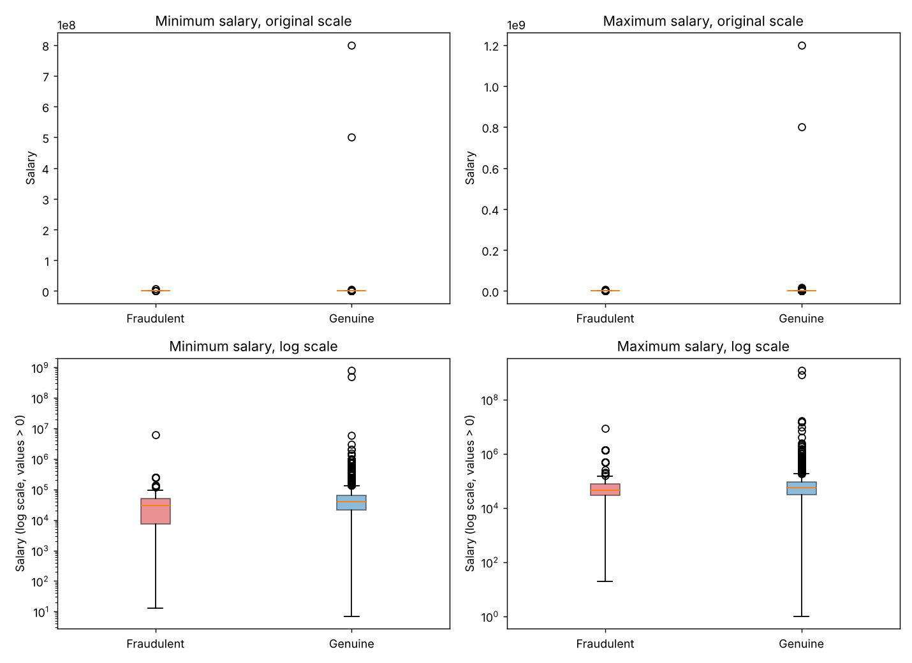

# PySpark: Fraudulent Job Postings and Movie Genre Co-occurrence

Two Apache Spark analyses written in PySpark. The first compares 17,880 fraudulent and genuine job advertisements, focusing on salary patterns, outliers and description wording. The second joins 100,000 MovieLens ratings with movie genres to find which genres most often appear together.

Module: ICT337 Big Data Computing in the Cloud, Singapore University of Social Sciences (2026)

## Contents

| Folder | Program | What it does |
|---|---|---|
| `fraudulent_job_postings` | `fraud_jobs_analysis.py` | Salary extraction with UDFs, salary statistics, distribution charts, two outlier-removal methods and n-gram analysis |
| `movie_genre_cooccurrence` | `genre_cooccurrence.py` | RDD joins and pair counting to rank co-occurring genres |

Each folder also has a `sample_output.txt` with the full output of a run. The charts are in `fraudulent_job_postings/outputs/`.

## 1. Fraudulent job postings

**Data:** 17,880 job ads, of which 866 (4.8%) are fraudulent.

1. **Salary extraction:** two UDFs read the minimum and maximum from `salary_range` text such as `20000-28000`. Values could be extracted from 2,841 ads; 27 could not, mostly because they had been converted to dates such as `10-Oct`.
2. **Salary statistics:** the medians are similar (minimum salary 30,000 for fraudulent ads vs 36,000 for genuine ones), but the means and standard deviations are distorted by extreme values (a genuine standard deviation of about 18.4 million).
3. **Distributions:** boxplots and histograms on original and log scales show that both groups share one main peak. The difference is in the extremes: fraudulent ads are about 5.6 times more likely to list a maximum salary above 1,000,000.

   

4. **IQR filtering:** quartiles from Spark's `percentile()` set bounds of Q1 - 1.5 × IQR and Q3 + 1.5 × IQR for each group.
5. **Reusable outlier functions:** `calculate_bounds()` and `flag_outliers()` combine the IQR bounds with realistic salary limits, so fewer genuine postings are removed. 18 fraudulent and 94 genuine ads were flagged, and the mean minimum salary for genuine ads fell from 553,651 to 40,866.
6. **N-grams:** descriptions are lower-cased and stripped of non-letters, tokenised with `RegexTokenizer`, and passed to `NGram` to count the top bi-grams and tri-grams for each group.

## 2. Movie genre co-occurrence (RDDs)

1. Parse ratings into `(movie ID, (user ID, rating))` and movies into `(movie ID, (title, release date, genre list))`, using a broadcast variable for genre names.
2. `join` the two RDDs on movie ID (100,000 records).
3. `flatMap` every rating into all ordered pairs of its movie's genres, then `reduceByKey` to count each pair.
4. Group by the first genre and keep its top 3 partners.

The strongest pairs are Action + Adventure (10,305), Action + Thriller (10,100), Drama + Romance (8,017), Action + Sci-Fi (7,968) and Comedy + Romance (7,542).

## How to run

You need Java and Python 3.

```bash
pip install pyspark numpy matplotlib
spark-submit fraudulent_job_postings/fraud_jobs_analysis.py
spark-submit movie_genre_cooccurrence/genre_cooccurrence.py
```

- `fraud_jobs_analysis.py` expects `fraud_jobs.csv` (the public EMSCAD fake job postings dataset) in its folder.
- `genre_cooccurrence.py` expects the [MovieLens 100K](https://grouplens.org/datasets/movielens/100k/) files renamed as `mov_rating.dat` (u.data), `mov_genre.dat` (u.genre) and `mov_item.dat` (u.item).

The datasets are not included here.

## Skills demonstrated

- PySpark DataFrames: multi-line CSV parsing, UDFs, percentiles, joins and `unionByName`
- Outlier detection and handling with the IQR method
- Text processing with Spark ML (`RegexTokenizer`, `NGram`)
- PySpark RDDs: `binaryFiles`, broadcast variables, `join`, `flatMap` and `reduceByKey`
- Visualisation with matplotlib

## Author

Jawenn Lim
